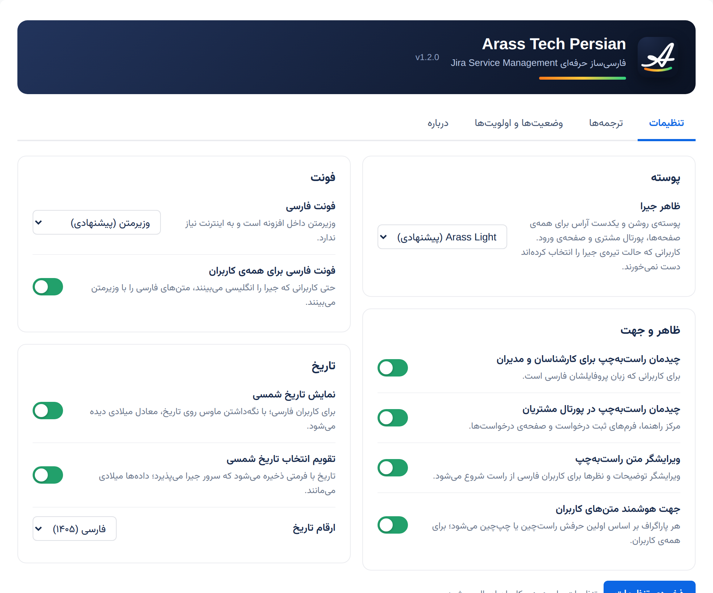

<div dir="rtl">

# فارسی‌ساز Jira — Arass Tech Persian

افزونه‌ی **رایگان و متن‌باز** برای فارسی کردن کامل **Jira Software** و **Jira Service Management** نسخه‌ی **Data Center**:
ترجمه‌ی کامل، چیدمان راست‌به‌چپ، فونت وزیرمتن و تاریخ شمسی.

[📦 دانلود آخرین نسخه](../../releases/latest) · [📘 راهنمای نصب (PDF)](docs/install-guide-fa.pdf) · [تغییرات نسخه‌ها](CHANGELOG.md)



## امکانات

- **ترجمه‌ی کامل فارسی** رابط Jira و Jira Service Management، به‌صورت یک زبان جدید: «Persian (Iran)»
- **چیدمان راست‌به‌چپ** با دو سوئیچ جدا: یکی برای کارشناسان و مدیران، یکی برای پورتال مشتریان
- **فونت وزیرمتن** داخل خود افزونه، بدون نیاز به اینترنت
- **تاریخ شمسی**: نمایش تاریخ‌ها به شمسی، به‌همراه تقویم انتخاب تاریخ شمسی
  - خود فیلد تاریخ شمسی را نشان می‌دهد، مثلاً «۴ مهر ۱۴۰۵».
  - داده‌ها در Jira همچنان میلادی ذخیره می‌شوند.
- **جهت هوشمند متن**: هر پاراگراف بر اساس اولین حرفش راست‌چین یا چپ‌چین می‌شود.
- **ویرایشگر راست‌به‌چپ** برای توضیحات و نظرها
- **ارقام فارسی یا لاتین** در تاریخ‌ها
- **صفحه‌ی تنظیمات** در بخش مدیریت:
  - روشن و خاموش کردن هر قابلیت
  - ویرایش هر متن ترجمه، با امکان خروجی و ورودی JSON
  - نام فارسی وضعیت‌ها، اولویت‌ها، نتیجه‌ها و انواع مسئله
- **بی‌اثر روی کاربران انگلیسی**: زبان، راست‌چین شدن و تاریخ شمسی فقط برای کاربرانی است که زبانشان فارسی است. تم ظاهری و فونت حروف فارسی برای همه اعمال می‌شود که از صفحه‌ی تنظیمات قابل خاموش کردن است.

## سازگاری

| | |
|---|---|
| Jira | Data Center ‏10.x (تست‌شده روی 10.3) |
| Jira Service Management | Data Center ‏10.x (تست‌شده روی 10.3) |
| جاوا | 17 یا بالاتر (همان جاوای Jira 10) |

## نصب سریع

راهنمای کامل، قدم‌به‌قدم و با تصویر در فایل [docs/install-guide-fa.pdf](docs/install-guide-fa.pdf) است. خلاصه‌ی نصب روی لینوکس:

</div>

```bash
# 1) Jira را متوقف کنید
sudo systemctl stop jira

# 2) نسخه‌ی قبلی افزونه را (اگر هست) بردارید و نسخه‌ی جدید را کپی کنید
cd /var/atlassian/application-data/jira/plugins/installed-plugins/
sudo rm -f arasstech-persian-jsm-*.jar
sudo cp ~/arasstech-persian-jsm-1.2.0.jar .
sudo chown jira:jira arasstech-persian-jsm-1.2.0.jar

# 3) Jira را روشن کنید
sudo systemctl start jira
```

<div dir="rtl">

بعد از بالا آمدن Jira، هر کاربر از **پروفایل ← ترجیحات ← زبان** گزینه‌ی **Persian (Iran)** را انتخاب می‌کند.

## ساخت از کد منبع

پیش‌نیازها: JDK 17 یا بالاتر، python3، و فایل‌های API خود Jira. فایل‌های Atlassian در این مخزن نیستند و از نصب Jira خودتان کپی می‌شوند.

</div>

```bash
sudo tools/collect-jira-api.sh /opt/atlassian/jira   # copies Jira's API jars into ./lib
tools/build.sh 1.2.0                                 # → dist/arasstech-persian-jsm-1.2.0.jar
```

<div dir="rtl">

## مجوز

این افزونه با مجوز [MIT](LICENSE) منتشر شده و استفاده، تغییر و انتشار آن آزاد است.
فونت وزیرمتن، اثر صابر راستی‌کردار، با مجوز SIL Open Font License 1.1 همراه افزونه است.
Jira و Atlassian نشان‌های تجاری Atlassian هستند و این پروژه وابسته به Atlassian نیست ([NOTICE](NOTICE.md)).

ساخته‌شده توسط [Arass Tech](https://arasstech.ir).

</div>

---

## English

**Arass Tech Persian** is a free, open-source (MIT) app that adds a complete Persian (Farsi) experience to
**Jira Software / Jira Service Management Data Center 10.x**: full translation (a new "Persian (Iran)" language),
right-to-left layout for agents and the customer portal, the bundled Vazirmatn typeface, and Jalali (Shamsi) dates
with a Jalali date picker. Data is still stored in Gregorian. English users are not affected.

- **Download:** [latest release](../../releases/latest)
- **Install:** stop Jira, copy the jar into `<jira-home>/plugins/installed-plugins/`, start Jira
  (on a cluster, use the shared home).
  Each user then picks *Profile → Preferences → Language → Persian (Iran)*.
- **Build:** `tools/collect-jira-api.sh` then `tools/build.sh <version>` (JDK 17+).
- Jira and Atlassian are trademarks of Atlassian. This project is not affiliated with Atlassian.
